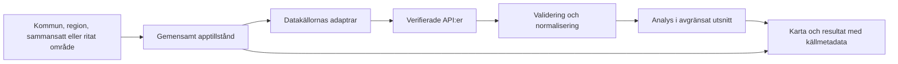

# Arkitektur

Status: beslutad utgångspunkt för implementation. P1-grunden är implementerad och sammanslagen till `main`. P2 pågår med datakontrakt, validering, källunderlag, testfixturer och kart-api-adaptrar; lokala P2-ändringar är ännu inte fullständigt committade eller granskade. Gränssnittet visar fortfarande bara bakgrundskartan. Aktuell funktionsstatus finns i README och beslut dokumenteras i docs/DECISIONS.md.

## Grundval

En statisk webbklient byggs med TypeScript, Vite och Leaflet. Ingen server eller databas behövs innan ett verifierat behov finns. Valet bygger vidare på Gabrielas erfarenhet av Leaflet, HTML, CSS och JavaScript och lämpar sig för en första GitHub-publicering samt senare drift på gislab.se.

Välj aktuella stödda biblioteksversioner när projektgrunden skapas, ange Node-version och checka in package-lock.json. Rita-funktionen behöver ett Leaflet-kompatibelt verktyg; välj efter kontroll av underhåll, licens, mobilstöd och redigering. Biblioteket är ännu inte valt.

## Dataflöde



Adaptrarna kapslar in leverantörernas svar och fel. UI och analys får interna, validerade datatyper. Byte av leverantör ska inte kräva ändringar i varje kartkomponent.

## Planerad struktur

Strukturen skapas successivt av Gabriela i P1–P7. Alla kataloger nedan finns inte ännu.

```text
src/
  main.ts                 start och komposition
  config/                 startvyns koordinater som konfigurationsdata
  map/                    kartlager, urval och ritverktyg
  ui/                     formulär, resultat, legend och status
  state/                  valt område, laddning och resultat
  providers/              kart-api, SCB och normalisering
  analysis/               rena beräkningar och rumsliga urval
  domain/                 gemensamma typer och validering
public/                    små tillåtna statiska resurser
scripts/                   reproducerbara data- och byggverktyg
tests/                     kontrakt, analys och användarflöden
docs/                      metoder, beslut och drift
```

## Interna kontrakt

P2 innehåller de fem typerna nedan samt runtime-validering och små lagligt delbara provsvar. Det nuvarande områdeskontraktet täcker kommun och ritat område; regioner och sammansatta områden kräver en senare, separat utvidgning.

| Objekt | Minsta information |
| --- | --- |
| AreaOfInterest | ID, namn, urvalstyp, geometri och geometriårgång |
| SourceMetadata | Leverantör, käll-URL, licens/attribution, referenstid, hämtningstid, CRS och geografisk täckning |
| MunicipalityStatistics | Kommunkod som text, folkmängd, landareal, täthet, enheter och saknatillstånd |
| PopulationGridCell | Stabilt rut-ID, hel rutgeometri, populationsvärde/saknatillstånd och källmetadata |
| AnalysisResult | Mått, värde, enhet, geografisk referens, metod, källmetadata, fullständighet och begränsningar |

Skilj mellan `loading`, `ready`, `empty` och `error`. Ett lyckat svar kan vara ofullständigt eller begränsat av ett API-tak. Det får inte visas som fullständig täckning.

## Koordinater och beräkningar

- Webbgeometrier: GeoJSON i WGS 84, EPSG:4326, med [longitud, latitud]. Leaflets egna koordinatpar följer bibliotekets kontrakt och måste konverteras uttryckligt vid gränsen.
- Källdata kan ha SWEREF 99 TM, EPSG:3006, eller andra CRS. Kontrollera metadata före omprojektion.
- Arealer: använd publicerad SCB-landareal för kommunstatistik. Geometrisk yta beräknas med dokumenterad geodetisk metod eller projektion avsedd för beräkningen; ytan är inte automatiskt landareal.
- Analysfunktioner ska kunna testas utan kartbibliotek eller nätverk.

## Nätverk och prestanda

Hämta ett begränsat utsnitt efter bekräftat områdesval. Avbryt inaktuella anrop, fördröj sökning under pågående skrivning och återanvänd identiska svar. Matcha varje svar mot det områdesval som startade anropet så att ett sent svar inte ersätter aktuell vy.

P2 ska verifiera CORS, paginering, maxstorlek, felkoder, geografiskt filter och villkor för cache. En godkänd dokumentationslänk är inte ett godkänt integrationstest. Nationella rådata får inte lastas in vid varje sidvisning.

Om datakällan inte kan användas direkt från webbläsaren väljs antingen en annan tillåten källa, ett tillåtet förberett utdrag eller en liten serveradapter. Hemliga nycklar kräver serveradapter. Det beslutet tas före implementation av beroende funktioner.

## Publicering och kvalitet

Källkoden är offentlig i `yakimovskagabriela-ctrl/platsorientering`. Vid push till detta repos `main` kör GitHub Actions tester och bygger med Vite-bas `/platsorientering/`. Endast `dist/` laddas upp som Pages-artefakt. Deployment-jobbet kräver godkänt byggjobb och använder repots automatiska `GITHUB_TOKEN` med `pages: write` och `id-token: write`. Ingen överföring mellan repon behövs. Den verkliga Pages-URL:en verifieras efter publiceringen. Slutversionens resurser och dataanrop ska även fungera under den bekräftade sökvägen på gislab.se. Startversionen behöver ingen klientrouter eller SPA-omskrivning.

Gabriela inför typkontroll, enhetstester för analys och integrationstester med sparade provsvar. Ett webbläsartest ska täcka platsval → resultat → rita → sammanställning. Live-API-kontroll hålls separat så att kvoter och externa driftfel inte gör vanliga tester instabila.
